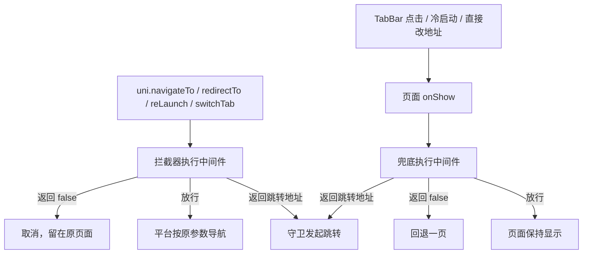

<a href="https://github.com/uni-helper/vite-plugin-uni-middleware"></a>

# @uni-helper/vite-plugin-uni-middleware

<p align="center">
  
</p>
<p align="center">
  <a href="https://github.com/uni-helper/vite-plugin-uni-middleware/blob/main/LICENSE"></a>
  <a href="https://github.com/uni-helper/vite-plugin-uni-middleware/stargazers"></a>
  <a href="https://npmx.dev/package/@uni-helper/vite-plugin-uni-middleware"></a>
  <a href="https://npmx.dev/package/@uni-helper/vite-plugin-uni-middleware"></a>
</p>
<p align="center">
  <a href="https://github.com/KeJun"></a>
  <a href="https://github.com/ModyQyW"></a>
</p>

在 Vite 驱动的 uni-app 中使用路由中间件。

不想看文档？直接问 AI 🤖 <a href="https://deepwiki.com/uni-helper/vite-plugin-uni-middleware"></a>

## 简介

中间件写在 `src/middleware` 目录里，构建时由插件扫描并生成虚拟模块，运行时在跳转发生前执行。页面和全局都可以挂中间件，返回值决定放行、取消还是改道。

## 安装

```bash
pnpm i -D @uni-helper/vite-plugin-uni-middleware
```

## 快速开始

在 `vite.config.ts` 里注册插件：

```ts
// vite.config.ts
import Uni from '@dcloudio/vite-plugin-uni'
import UniMiddleware from '@uni-helper/vite-plugin-uni-middleware'
import { defineConfig } from 'vite'

export default defineConfig({
  plugins: [Uni(), UniMiddleware()],
})
```

写一个中间件：

```ts
// src/middleware/auth.ts
import { defineMiddleware } from '@uni-helper/vite-plugin-uni-middleware/runtime'
import { useStore } from '../store'

export default defineMiddleware((to) => {
  const store = useStore()
  if (!store.isLogin) {
    return '/pages/login/index'
  }
})
```

在 `pages.json` 里挂到页面：

```jsonc
// src/pages.json
{
  "pages": [
    { "path": "pages/index/index" },
    { "path": "pages/vip/index", "middleware": ["auth"] }
  ]
}
```

在 `main.ts` 里注册守卫，把虚拟模块导出的中间件表传进去：

```ts
// src/main.ts
import { createNavigationGuardPlugin } from '@uni-helper/vite-plugin-uni-middleware/runtime'
import { middlewares } from 'virtual:uni-middleware'
import { createSSRApp } from 'vue'
import App from './App.vue'

export function createApp() {
  const app = createSSRApp(App)
  app.use(createNavigationGuardPlugin(middlewares))
  return { app }
}
```

## 拦截方式

守卫有两个入口，覆盖 uni-app 里的所有页面进入方式。

**导航 API 拦截器优先。** `uni.navigateTo`、`uni.redirectTo`、`uni.reLaunch`、`uni.switchTab` 调用时先执行中间件，被拦下的跳转不会发生，页面不会渲染，页面栈也不会多出一层。中间件是同步函数时，放行的跳转由平台原样执行；中间件返回 Promise 时，守卫先取消这次跳转，等结果出来再自己发起。

**`onShow` 兜底。** 有三类入口不经过上面四个 API：TabBar 点击(微信小程序点击 TabBar 走的是原生逻辑，不会触发 `uni.switchTab`)、小程序冷启动、H5 直接改地址栏。页面显示后守卫再执行一次中间件，需要改道时再跳走。这条路径上页面已经渲染出来，会看到一次短暂的闪现。



两条路径不会重复执行同一组中间件：拦截器放行的页面显示时直接跳过，同一页面反复 `onShow`(比如从后台切回)也只执行一次。

两次页面之间互相跳转会被拦住：守卫记录已经离开的页面，发现又跳回时就停止跳转并报错。

## 中间件返回值

| 返回值 | 行为 |
| --- | --- |
| `undefined` / `true` | 放行 |
| `false` | 取消本次导航；页面已经显示时回退一页，页面栈只有这一页时只报错 |
| `string` | 当作跳转地址，用 `uni.redirectTo` 跳转 |
| `{ url, method?, options? }` | 指定跳转方式，`method` 默认 `redirectTo`，可选 `navigateTo`、`redirectTo`、`reLaunch`、`switchTab` |

多个中间件按「全局 → 页面」的顺序执行，遇到第一个不放行的结果就停下，后面的中间件不再执行。中间件抛出的异常会打印到控制台，然后继续执行下一个，不会把用户卡在页面上。

中间件可以返回 Promise，守卫会等它结束再决定：

```ts
export default defineMiddleware(async (to) => {
  if (!(await checkToken())) {
    return { url: '/pages/login/index', method: 'reLaunch' }
  }
})
```

`to` 和 `from` 是页面地址，不是页面实例：

```ts
interface RouteLocation {
  /** 页面路径，不带前导斜杠，如 pages/login/index */
  route: string
  /** 完整地址，带前导斜杠和查询串，如 /pages/login/index?from=home */
  url: string
}
```

`onShow` 兜底时拿不到查询串，`from` 的 `url` 只有 `/${route}`。

## 已知问题

- TabBar 点击、冷启动、H5 直接改地址只能等页面显示后再判断，受保护的页面会先渲染出来。要求完全不闪现，就把受保护页面放在普通页面里，别放进 TabBar。
- 被拦下的导航不会触发 `success` 和 `fail`，这是 uni-app 拦截器本身的行为。中间件给了跳转地址时，调用方的回调会挂到那次跳转上。
- 守卫跑在客户端，只能管界面。接口权限仍然要在服务端校验。
- H5 和小程序已用 playground 构建验证，App 平台没有验证过。

## 配置

| 字段 | 类型 | 默认值 | 说明 |
| --- | --- | --- | --- |
| `middlewareDir` | `string` | `"src/middleware"` | 中间件目录 |
| `pagesJsonPath` | `string` | `"src/pages.json"` | pages.json 的路径 |
| `programRoot` | `string` | `process.cwd()` | 上面两个相对路径的根目录 |

## API 参考

### `defineMiddleware`

```ts
function defineMiddleware(middleware: Middleware): Middleware
```

原样返回传入的函数，只用来拿类型提示。

### `createNavigationGuardPlugin`

```ts
function createNavigationGuardPlugin(middlewares: MiddlewareMap): ObjectPlugin
```

创建 Vue 插件，在 `main.ts` 里用 `app.use()` 注册。`middlewares` 就是虚拟模块 `virtual:uni-middleware` 导出的映射。注册会做两件事：给四个导航 API 添加拦截器，以及给所有页面混入 `onShow` 兜底。

中间件表必须由调用方传进来。运行时不导入虚拟模块：虚拟模块导入中间件文件，中间件文件通常又导入运行时（`defineMiddleware`，或者自己的 store），uni-app 会把这两头分到互相 `require` 的 chunk 里。构建报 `Circular chunk`，小程序产物里的 `middleware/*.js` 还会在 `common/vendor.js` 定义导出之前调用它。

### 类型

```ts
type Middleware = (to: RouteLocation, from?: RouteLocation) => MiddlewareReturn | Promise<MiddlewareReturn>

type MiddlewareReturn
  = | void
    | boolean
    | string
    | {
      url: string
      method?: 'navigateTo' | 'redirectTo' | 'reLaunch' | 'switchTab'
      options?: Record<string, unknown>
    }
```

### 虚拟模块

插件在构建时生成 `virtual:uni-middleware`，导出 `middlewares` 映射，在 `main.ts` 里传给 `createNavigationGuardPlugin`。需要类型提示时在 `env.d.ts` 里加一行：

```ts
/// <reference types="@uni-helper/vite-plugin-uni-middleware/client" />
```

## 页面配置

默认直接写 `pages.json`：

- 顶层 `middleware` 是全局中间件，每个页面都会跑。
- `pages[].middleware` 只作用于这一页。
- 全局中间件排在页面中间件前面；同一层里按 `middleware` 数组的顺序执行，同一个名字写两遍也只跑一次。
- 名字在 `src/middleware` 里找不到时，构建会打印警告，这一条跳过。

```jsonc
// src/pages.json
{
  "middleware": ["global"],
  "pages": [
    { "path": "pages/index/index" },
    { "path": "pages/vip/index", "middleware": ["auth", "vip"] }
  ]
}
```

### 配合 vite-plugin-uni-pages

[vite-plugin-uni-pages](https://github.com/uni-helper/vite-plugin-uni-pages) 扫描页面后生成 `pages.json`，本插件读的是生成后的文件，所以两者要一起用。建议把 `UniPages()` 写在 `UniMiddleware()` 前面，让插件读 `pages.json` 时文件已经生成：

```ts
// vite.config.ts
import Uni from '@dcloudio/vite-plugin-uni'
import UniMiddleware from '@uni-helper/vite-plugin-uni-middleware'
import UniPages from '@uni-helper/vite-plugin-uni-pages'
import { defineConfig } from 'vite'

export default defineConfig({
  plugins: [UniPages(), Uni(), UniMiddleware()],
})
```

全局中间件写在 `pages.config.ts`：

```ts
// pages.config.ts
import { defineUniPages } from '@uni-helper/vite-plugin-uni-pages'

export default defineUniPages({
  middleware: ['global'],
})
```

页面级中间件写在页面文件的 `definePage` 里：

```vue
<!-- src/pages/vip/index.vue -->
<script setup lang="ts">
definePage({
  middleware: ['auth', 'vip'],
})
</script>
```

uni-pages 0.4 起移除了 `<route>` 自定义块，写在那里的字段进不了 `pages.json`，页面级配置只能写在 `definePage` 里。`middleware` 没有专门的类型声明，`PageItem` 带字符串索引签名，名字写错不会有编辑器提示，只能等构建时的警告。

`definePage` 是全局宏，编辑器要认识它得引用 uni-pages 的类型：

```ts
// src/env.d.ts
/// <reference types="@uni-helper/vite-plugin-uni-pages/client" />
```

## 工作方式

- 构建期
  1. 扫描 `middlewareDir`，按文件路径推导中间件名：文件名为 `index` 时改用目录名；目录段从外往里拼到文件名前面，遇到和文件名第一段相同的目录段就停下；最后转成 camelCase。`user/profile.ts` 变成 `userProfile`，`vip/index.ts` 变成 `vip`。
  2. 读取 `pages.json`，把顶层 `middleware` 和 `pages[].middleware` 里的名字换成扫描到的函数。
  3. 生成虚拟模块 `virtual:uni-middleware`。开发时改中间件或 pages.json 会触发整页刷新。
- 运行期
  1. `main.ts` 先导入虚拟模块，把中间件表交给 `createNavigationGuardPlugin(middlewares)`，再用 `app.use()` 注册拦截器和 `onShow` 兜底。
  2. 导航时按「全局 → 页面」执行中间件，第一个不放行的结果决定后续。
  3. 中间件放行就按原参数继续，返回跳转就改道，返回 `false` 就取消或回退。

中间件表经过 `main.ts` 传递。uni-app 小程序构建把 `node_modules` 里的代码打包进 `common/vendor`，项目文件各自一个 chunk；如果运行时自己导入虚拟模块，`common/vendor` 和中间件 chunk 会互相 `require`。

pages.json 里写了不存在的中间件名，或者两个文件推导出同一个名字，构建期都会在终端给出警告。


## 从 0.0.x 升级到 0.1

0.1 起 `createNavigationGuardPlugin` 必须接收中间件表，零参调用会抛错：

```diff
// src/main.ts
+import { middlewares } from 'virtual:uni-middleware'
 import { createNavigationGuardPlugin } from '@uni-helper/vite-plugin-uni-middleware/runtime'
 import { createSSRApp } from 'vue'
 import App from './App.vue'

 export function createApp() {
   const app = createSSRApp(App)
-  app.use(createNavigationGuardPlugin())
+  app.use(createNavigationGuardPlugin(middlewares))
   return { app }
 }
```

零参写法让运行时自己导入虚拟模块，和中间件文件形成循环依赖：小程序构建会报 `Circular chunk`，产物里的 `middleware/*.js` 在 `common/vendor.js` 定义导出之前就调用了它。

## 关联项目

- [uni-helper/vite-plugin-uni-pages](https://github.com/uni-helper/vite-plugin-uni-pages) - 为 Vite 下的 uni-app 提供基于文件系统的路由
- [uni-helper/vite-plugin-uni-layouts](https://github.com/uni-helper/vite-plugin-uni-layouts) - 为 Vite 下的 uni-app 提供类 nuxt 的 layouts 系统
- [uni-helper/vite-plugin-uni-manifest](https://github.com/uni-helper/vite-plugin-uni-manifest) - 使用 TypeScript 来编写 uni-app 的 manifest.json
- [uni-helper/vite-plugin-uni-platform](https://github.com/uni-helper/vite-plugin-uni-platform) - 基于文件名的按平台编译插件

## 参与贡献

欢迎提交 [Issue](https://github.com/uni-helper/vite-plugin-uni-middleware/issues) 和 [Pull Request](https://github.com/uni-helper/vite-plugin-uni-middleware/pulls)，请先阅读 [CONTRIBUTING.md](./CONTRIBUTING.md)。

## 许可证

基于 [MIT](https://github.com/uni-helper/vite-plugin-uni-middleware/blob/main/LICENSE) 许可发布。
